

  

<h1 align="center">CLOAKD</h1>

<em>Dress your best.</em>

 
## Milestone 2 Submission
 
**Team Name:** CLOAKD
 
**Proposed Level of Achievement:** Apollo 11
 
---

 
## Motivation
 
For most people, us included, getting dressed is stressful. You stand in front of a full wardrobe and somehow still feel like you have nothing to wear. CLOAKD reframes that daily moment as something expressive and enjoyable instead of a chore and removes the anxiety from picking out an outfit.
 
Most people wear fewer than a third of the clothes they own. The average piece of clothing gets worn just 7 times before it's thrown away and 40% of what we buy never gets worn at all. People keep buying new clothes and feeling like they constantly have nothing to wear not because they lack options, but because they can't see what they already have. CLOAKD solves a **visibility problem, not a shopping problem.**
 
Fast fashion is one of the most polluting industries in the world, but telling people to "buy less" doesn't work. CLOAKD takes a different approach by making it fun, social and rewarding to get more out of the clothes you already own. The cost-per-wear tracker and wardrobe utilisation score turn sustainability into a game rather than a guilt trip.
 
We also wanted to build something that brings people together around style in a way that feels real and also to learn how to take an idea from nothing and turn it into something real while picking up software engineering skills along the way by building something we actually care about.
 
---
 
## Vision
 
CLOAKD will be a mobile app for iOS and Android, built with React Native and Expo. It lets users digitise their entire wardrobe and receive daily outfit suggestions built entirely from clothes they already own, filtered by real-time weather and occasion.
 
The app is designed around a simple daily loop: open the app, get a suggestion tailored to today's weather and occasion, log what you wore and watch your wardrobe come alive through stats, streaks and community sharing.
 
Ultimately, we envision CLOAKD as the app people reach for every morning, the one that changes how they relate to the clothes they already own, reduces mindless overconsumption and makes getting dressed something enjoyable.

---

## User Stories
 
1. As a person who wants to dress better and improve my style, I want to be able to visualise and plan my outfits.
2. As a person who struggles with deciding what to wear, I want to be able to receive outfit suggestions for the day.
3. I want to be able to dress well and look stylish no matter the weather, even if it is a blazing hot day or a rainy day with thunderstorms. I also want to be able to dress appropriately for the occasion, such as date nights, formal occasions or gym days.
4. I want to be able to take inspiration from others' outfits and share my own.
5. As a frugal person, I want to be able to track how much value and how many wears I am getting out of my clothes.
6. I want to keep track of the outfits I have worn each day so that I do not repeat outfits too frequently.
7. As someone with a large wardrobe, I want to be able to search and filter my clothes by colour, category or material so that I can quickly find what I'm looking for without digging through my closet.
8. As someone who hasn't worn certain pieces in a long time, I want to be reminded of clothes I've forgotten about so that I can rediscover and make better use of them.
9. As someone who is trying to be more intentional about shopping, I want to see which gaps actually exist in my wardrobe before buying anything new.
10. As a conscious consumer, I want to understand the true cost of my purchases over time so that I can justify spending more on quality pieces that I'll wear repeatedly.
11. As someone who enjoys fashion, I want to browse trending outfits in the community and save looks that inspire me so that I have a personalised mood board to reference when planning my own outfits.
12. As someone who enjoys tracking personal progress, I want to look back at my outfit history over weeks and months so that I can see how my personal style has evolved.

---

## Proof of Concept

  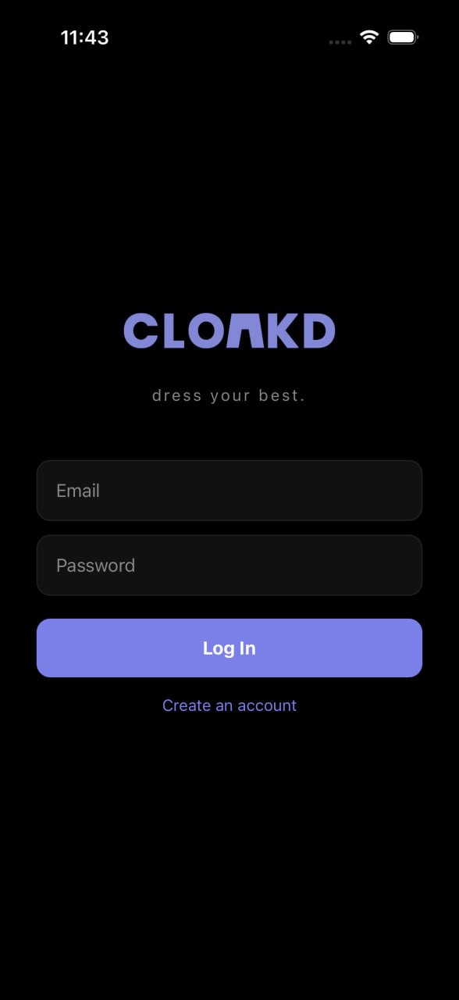

  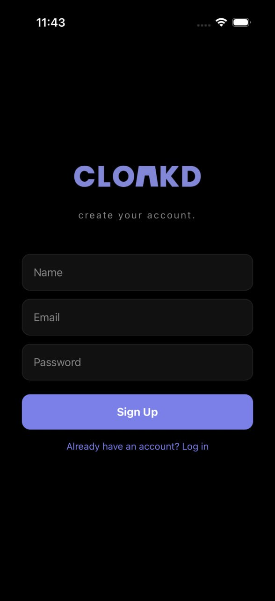

  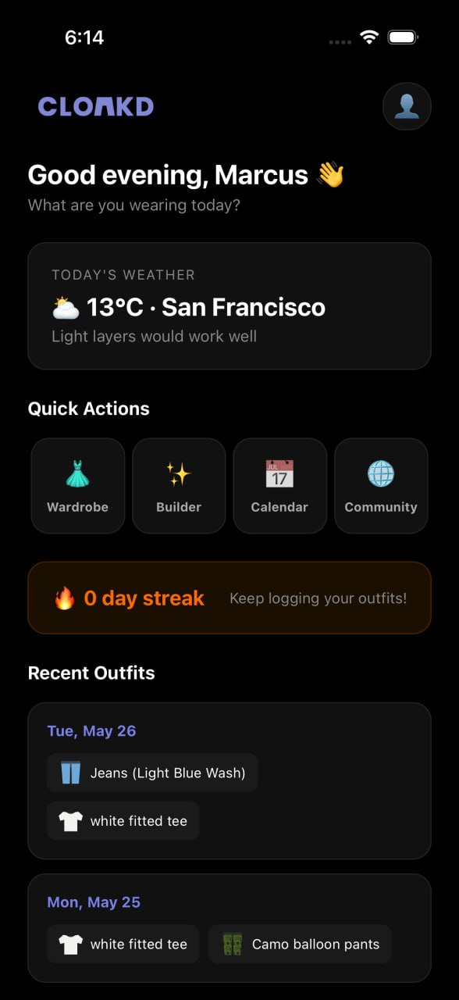

  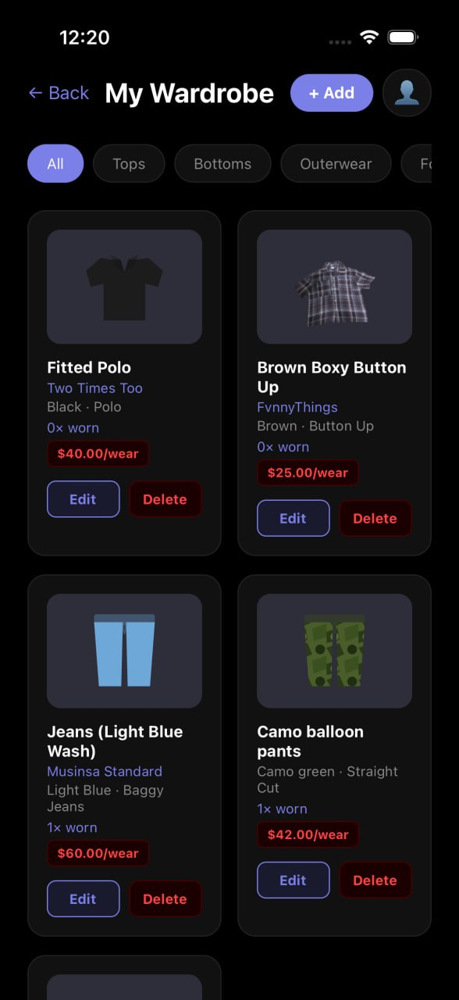

  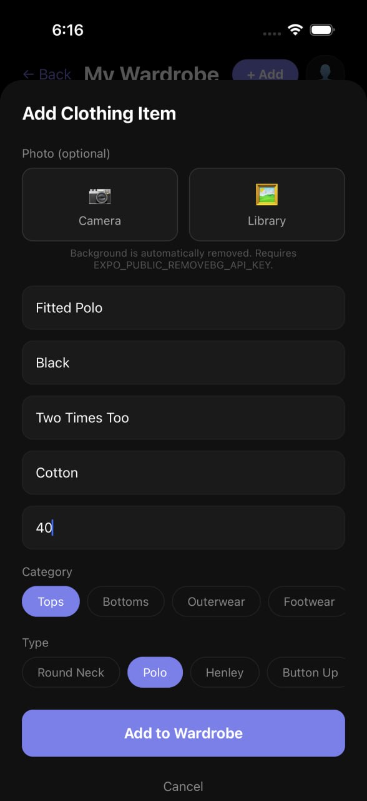

  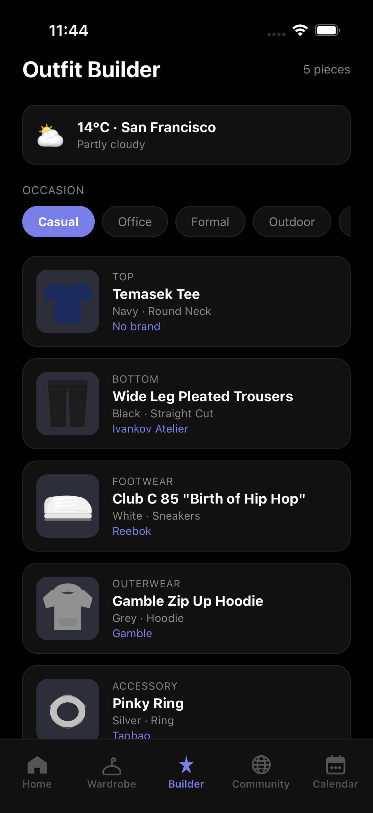

  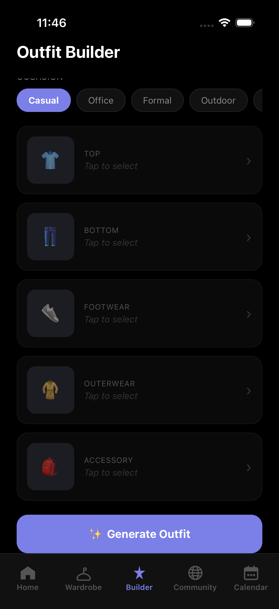

  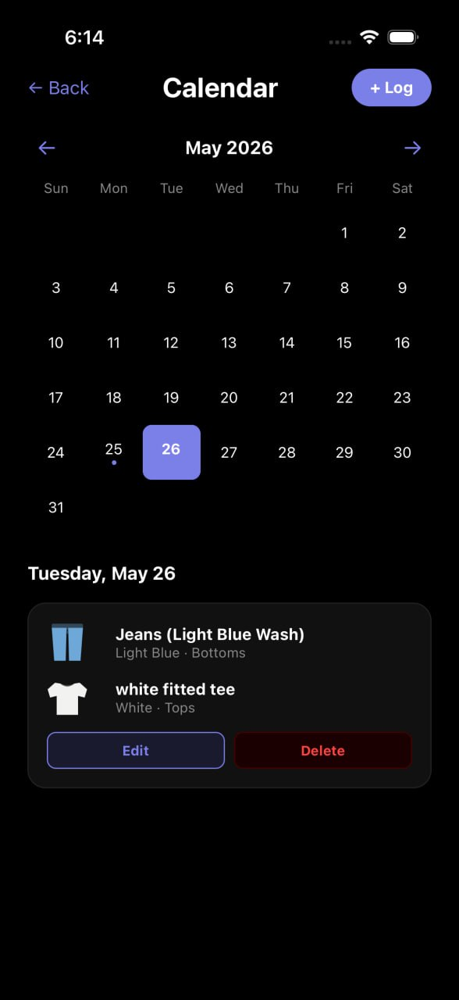

  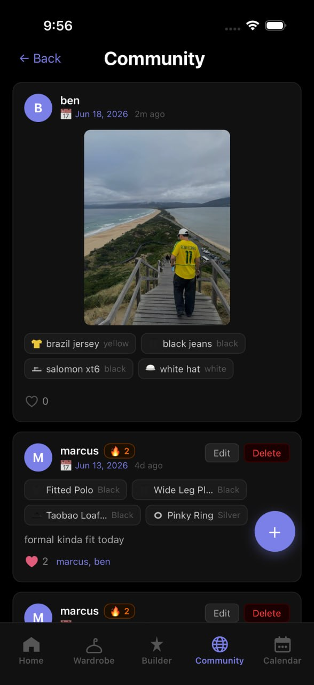

  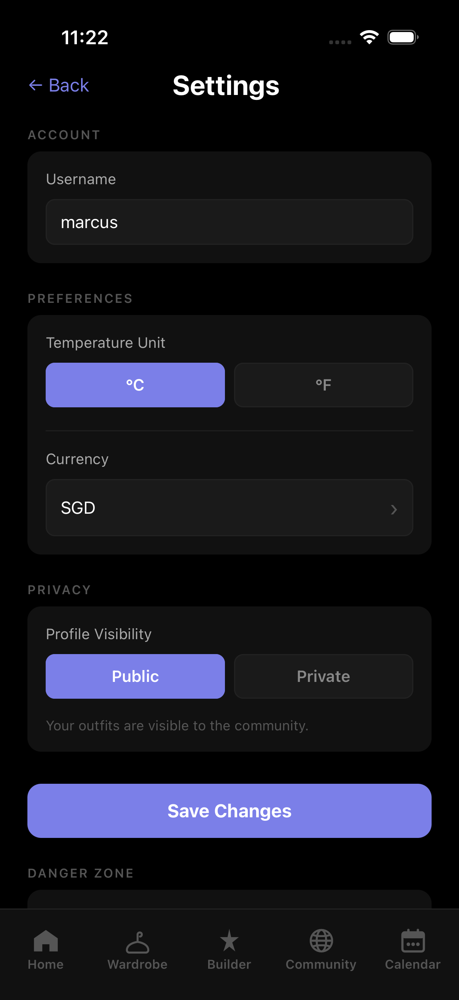

  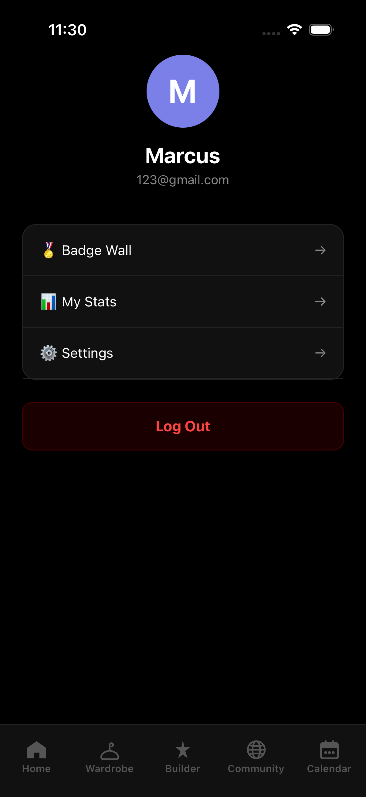

  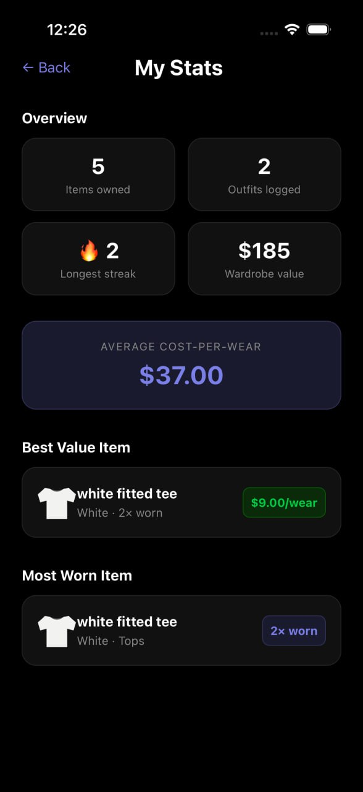

---

 
## Scope of Project
 
CLOAKD is a mobile app that lets users photograph and catalogue every clothing item they own, then suggests daily outfits built entirely from their existing wardrobe — filtered by real-time weather and occasion. Users log outfits to a calendar, track cost-per-wear statistics, build daily streaks, and optionally share looks to a community feed.
 
CLOAKD's features are outlined in the following sections, organised by the following tags:
 
- **[Proposed]** — features targeted for completion
- **[Current Progress]** — what has been built so far

---

 
## Features

### User Account Authentication

  

  

**[Proposed]**

Each user will be authenticated with their own unique account. Utilising the Firebase SDK Authentication, users can log in via Email and Password. They will be able to create an account if the user does not already have an existing account. Based on the user’s action, the relevant call to the Firebase authentication instance is made. The FirebaseAuthExceptions are handled within a try-catch block and an alert bar is displayed when the user keys in an invalid input. Only upon successful login or account registration will the user be routed to the next page and the account reflected in the Firebase authentication. 

**[Current Progress] (Completed)**

Users are able to either log in with their existing account if they have already made one or sign up for a new account with their name, email and password. Upon inputting their log in information, if their account exists and their information is correct, they will be redirected to the home page of their account.

---

 
### Virtual Wardrobe

  

  

**[Proposed]**
 
Users add their clothes by uploading a photo of each item and tagging it with basic details such as colour, category, subcategory, material, brand and purchase price. The wardrobe screen displays all items at a glance, filterable by category, colour or occasion in one tap. Items that have not been worn for 30 or more days and new items that have been added but are yet to be worn are surfaced automatically to encourage rediscovery.
 
**[Current Progress] (Completed)**
 
Users can save clothing items with basic tags (category, subcategory, colour, material, brand and purchase price) to the database via Supabase. The wardrobe grid view is functional and displays all saved items. Image capturing and background removal has been implemented. Filtering and the 30-day rediscovery have been implemented as well.
 
---
 

### Outfit Builder

  

  

 
**[Proposed]**
 
The outfit builder suggests outfit combinations built entirely from clothes the user already owns. The user is presented with a top, bottom, outerwear, footwear and accessories slot. Each slot is independently swappable, meaning the user can keep what they like and shuffle individual pieces. Weather and occasion filters are applied before suggestions load. Finalised outfits can be saved and logged.
 
**[Current Progress] (Completed)**
 
Basic outfit builder feature has been created. Builder will retrieve real time weather data and ask for the type of occasion (casual, office, formal, outdoor, date night). Users can then select each individual item from their wardrobe if they want to build the outfit themselves or they can click the generate outfit button and the builder will do all the work for them. The outfit builder uses specific colour combinations that go well with each other to build the outfit. Once the user is satisfied with the outfit, they can click log outfit and the outfit will be saved and logged on the calendar as well. 30-day rediscovery and pushing of unworn pieces has not been fully implemented in the builder yet.

---

 
### Occasion and Weather Filter

  

 
**[Proposed]**
 
The filter asks the user where they are going and what they will be doing. It uses real-time weather data from the Open-Meteo API for the user's location and filters the wardrobe to suggest outfits suitable for the conditions and occasion. Supported occasions: casual, office, formal, outdoor, date night.
 
**[Current Progress] (Completed)**
 
Open-Meteo API integration is complete and returning live weather data for the user's current location. The logic to filter wardrobe items by temperature range and occasion tag has been connected to the outfit builder.
 
---
 

### Outfit Calendar

  

**[Proposed]**
 
The outfit calendar acts as a personal style diary. Every time a user logs an outfit, it is recorded against the specified date. Users can look back to see exactly what they wore and when. Logging an outfit automatically updates the wear count and cost-per-wear for every item in the outfit. The calendar also surfaces pieces that have not been worn in a while to encourage rediscovery. Users can also edit and delete outfits that have been logged previously.
 
**[Current Progress] (Completed)**
 
The calendar has been created and can be navigated by month. Logging an outfit to a date is functional and stored in the database. Automatic updating of wear counts on log is complete. Visual indicators for logged days as well as current date are displayed on the calendar grid. Clothing items that have not been worn in a while have not been set to be suggested yet.
 
---

 
### Share Outfits

  

  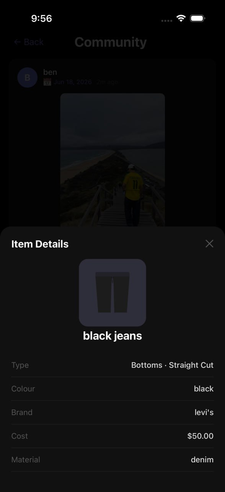

 
**[Proposed]**
 
Users can opt in to post outfits to the CLOAKD community feed. Privacy is the default, meaning that a user's wardrobe stays invisible unless they choose to share the outfits they build from it. Shared posts display only garment categories and colours, never purchase prices or private tags. Other users can like and save posts to their inspiration board.
 
**[Current Progress]**
 
The community feed is fully functional. Users can select a logged outfit, attach a photo and caption, and share it to the community feed. Each post displays the outfit date, caption, shared photo, and the individual clothing items as tappable chips.

Tapping a clothing chip opens a detail panel showing the item's name, category, subcategory, colour, brand, purchase price, and material — giving other users full context on each piece without exposing private data unnecessarily.

The liking system is complete. Users can like and unlike any post with a single tap. Like counts update immediately with optimistic UI and revert automatically on error. Users can tap the like count to see a list of everyone who has liked the post.

When a user updates their username in Settings, it propagates automatically across all their existing posts and likes in the community feed.
 
---

 
### Settings Page

  

  

**[Proposed]**
 
A dedicated settings screen lets users manage their account details and app preferences in one place. Users can set a display username, choose their preferred temperature unit, select their currency, and control the visibility of their profile. Account deletion is available as a permanent action behind a password confirmation step.

**[Current Progress] (Completed)**
 
The settings page is complete. Users can:

- **Username** — set a display name (minimum 3 characters, unique) that appears on all community posts and likes. Changing the username automatically updates it across all existing posts and likes in real time.
- **Temperature Unit** — toggle between °C and °F. The selection is persisted and reflected immediately in the home page weather card.
- **Currency** — select from SGD, USD, EUR, GBP, JPY, AUD, CAD, HKD, MYR, or IDR for cost-per-wear display.
- **Profile Visibility** — toggle between Public (outfits visible to the community) and Private (outfits visible to the user only).
- **Delete Account** — permanently deletes the account and all associated wardrobe data after password re-authentication. This action is irreversible.

---

 
### Profile Page

  

**[Proposed]**
 
Each user has a profile page that displays their username, profile photo, email address as well as their badge wall, stats and settings. The profile is accessible from the home page and serves as a personal hub for reviewing personal style history and achievements.

**[Current Progress] (Completed)**
 
The profile page is accessible from the profile button on the home page header. It is navigable and the user is able to access the stats page, the settings page as well as their badge wall from this page. In addition, the user is able to view their username, email address, profile photo on this page. The user can also log out from this page.

---

 
### Cost-Per-Wear Tracker

  

**[Proposed]**
 
When adding clothing items, users input the purchase price. Cost-per-wear is calculated as price divided by the number of wears and updated automatically each time the item is logged as part of an outfit. The wardrobe view surfaces this figure alongside wear count for each item, giving users a clear picture of the value they are getting out of their clothes.

**[Current Progress] (Completed)**
 
The cost-per-wear tracker has been fully built. Users can easily see the number of times they worn each piece of clothing and the cost-per-wear of it in the wardrobe page. Adding a clothing item to an outfit and logging it in the calendar automatically updated the wear count and cost-per-wear of that specific clothing item. There is also a stats page which shows users their best value clothing item (the one with the lowest cost-per-wear) and other statistics like their average cost-per-wear and most worn item.

---

### Streak System

  

  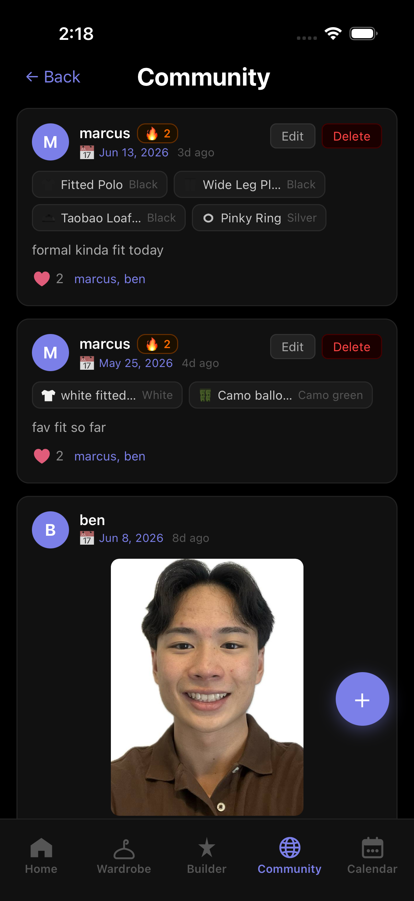

**[Proposed]**

Every day a user logs an outfit, their streak grows. Missing a day resets the counter. Badges unlock at 7-day, 30-day and 100-day milestones to keep users motivated to open the app daily.

**[Current Progress]**

The streak system is fully implemented. A streak is activated when a user logs outfits on 2 or more consecutive days. Missing a day resets the streak to 0. The streak counter is live on the home page, showing the current streak count with motivational subtext. Users with no active streak are prompted to log 2 days in a row to start one.

The streak is also visible in the community feed. When a user with an active streak (2+ days) shares an outfit, a fire icon and streak count appear next to their username on the post card, visible to all community members.

The badges page has been scaffolded and is accessible in the app. Badge unlock logic for streak milestones is planned for Milestone 3.

---

 
### Trending Outfits
 
**[Proposed]**

A weekly feed surfaces the most popular community outfits, ranked by an algorithm combining recency, saves and wardrobe diversity. This gives users fresh inspiration and rewards creativity with existing clothes over purchasing new ones.

**[Current Progress]**
 
The trending outfits algorithm has not been built yet.

---

## Testing

### Testing Approach

CLOAKD is tested through manual end-to-end testing and structured feature walkthroughs. Given the app's reliance on real-time data from Firebase and Supabase, we prioritise integration testing over mocked unit tests to ensure the full data flow works correctly in production conditions.

---

### Manual Test Cases

#### User Authentication
| Test | Expected Result | Status |
| --- | --- | --- |
| Sign up with a new email and password | Account created, redirected to home page | ✅ Pass |
| Log in with valid credentials | Redirected to home page | ✅ Pass |
| Log in with incorrect password | Error alert displayed, no redirect | ✅ Pass |
| Log in with unregistered email | Error alert displayed | ✅ Pass |
| Delete account with correct password | Account and data removed, redirected to login | ✅ Pass |
| Delete account with wrong password | Error alert, account retained | ✅ Pass |

#### Virtual Wardrobe
| Test | Expected Result | Status |
| --- | --- | --- |
| Add a clothing item with all fields | Item saved and visible in wardrobe grid | ✅ Pass |
| Add a clothing item with photo | Photo displayed in wardrobe grid and builder | ✅ Pass |
| Edit an existing clothing item | Updated details reflected immediately | ✅ Pass |
| Delete a clothing item | Item removed from wardrobe and any logged outfits | ✅ Pass |
| Filter wardrobe by category | Only matching items shown | ✅ Pass |

#### Outfit Builder
| Test | Expected Result | Status |
| --- | --- | --- |
| Generate an outfit | Items selected from wardrobe matching weather and occasion | ✅ Pass |
| Manually swap a slot | Selected item replaces the slot | ✅ Pass |
| Log a generated outfit | Outfit saved to calendar on the selected date | ✅ Pass |
| Generate outfit with empty wardrobe | Prompt shown with no crash | ✅ Pass |

#### Outfit Calendar
| Test | Expected Result | Status |
| --- | --- | --- |
| Log an outfit to a date | Date highlighted on calendar, wear counts updated | ✅ Pass |
| View a logged outfit | Items displayed correctly for that date | ✅ Pass |
| Navigate between months | Calendar updates without data loss | ✅ Pass |

#### Streak System
| Test | Expected Result | Status |
| --- | --- | --- |
| Log outfits on 2 consecutive days | Streak of 2 shown on home page | ✅ Pass |
| Skip a day after an active streak | Streak resets to 0 | ✅ Pass |
| Streak badge on community post | Fire icon and count appear beside username | ✅ Pass |
| Streak refreshes on home tab focus | Updated count shown after returning from calendar | ✅ Pass |

#### Community Feed
| Test | Expected Result | Status |
| --- | --- | --- |
| Share an outfit post | Post appears at top of community feed | ✅ Pass |
| Share a post with photo | Photo displayed in post card | ✅ Pass |
| Like a post | Like count increments immediately | ✅ Pass |
| Unlike a post | Like count decrements immediately | ✅ Pass |
| Like reverts on network error | Count restored to pre-tap state | ✅ Pass |
| View likers list | All usernames who liked the post are shown | ✅ Pass |
| Tap clothing chip | Item detail modal opens with correct data | ✅ Pass |
| Edit own post | Caption and photo updated in feed | ✅ Pass |
| Delete own post | Post removed from feed | ✅ Pass |

#### Settings
| Test | Expected Result | Status |
| --- | --- | --- |
| Change username | New username reflected on all existing posts and likes | ✅ Pass |
| Switch temperature unit to °F | Home page weather updates to Fahrenheit | ✅ Pass |
| Change currency | Currency setting persisted on next app open | ✅ Pass |
| Set profile to private | Posts hidden from community feed | ✅ Pass |

---

### Devices Tested

| Device | OS | Method |
| --- | --- | --- |
| iPhone 17 (Simulator) | iOS 18 | Xcode iOS Simulator |

> **Note:** Testing was conducted on a simulated iPhone 17 via Xcode rather than a physical device. This is because the version of Expo Go available on physical devices had not been updated to support the SDK version used in this project. A custom development build is required to run the app on a physical device.

---

### Known Limitations

- Testing is currently limited to the iOS Simulator. Physical device and Android compatibility testing is planned.
- Weather data accuracy is dependent on the Open-Meteo API and device location permissions being granted. Location is simulated in the Xcode Simulator and may not reflect real-world GPS accuracy.

 
## Timeline and Development Plan
 
| Milestone | Date | Task & Description |
| --- | --- | --- |
| Liftoff | 10 - 18 May 2026 | Create project poster. |
| Liftoff | 10 - 18 May 2026 | Film, edit and craft liftoff project poster. |
| Liftoff | 10 - 18 May 2026 | Finalise project features and review proposal. |

> **Evaluation Liftoff: 18 May 2026**
> - Create project poster and video.
> - Solidify plans for CLOAKD app.
> - Self-learn all the tools in our tech stack to build our CLOAKD app.

| Milestone | Date | Task & Description |
| --- | --- | --- |
| 1 | 19 - 24 May 2026 | Set up Expo project, Firebase backend and Supabase backend. Integrate Expo with Firebase for user authentication and Supabase for clothing item information. |
| 1 | 19 - 24 May 2026 | Create log-in and sign-up pages with user email and password for authentication and verification. |
| 1 | 19 - 24 May 2026 | Create home page as a dashboard that is connected to all other pages and features. |
| 1 | 24 - 31 May 2026 | Create virtual wardrobe feature with image capture and input of clothing item details such as colour, material, subcategory and purchase price. Link to Supabase for storage of details. |
| 1 | 24 - 31 May 2026 | Create outfit calendar feature with ability to log outfits and highlight dates where outfits have been logged. |
| 1 | 24 - 31 May 2026 | Create Cost-Per-Wear extension to update wear count every time the clothing item is logged in an outfit. Use purchase price / number of wears to calculate. |

> **Evaluation Milestone 1: 1 June 2026**
> - Able to add clothes to the virtual wardrobe + store and access data.
> - Outfit Calendar to be functional.
> - Calculation feature of Cost-per-wear Tracker to be functional. Integration with Virtual Wardrobe to be completed at a later date.
> - Account sign-up and log-in with authentication to be completed.
> - Basic UI complete.

| Milestone | Date | Task & Description |
| --- | --- | --- |
| 2 | 2 - 15 June 2026 | Create outfit builder feature and link it to the virtual wardrobe to directly access all clothing items. |
| 2 | 2 - 15 June 2026 | Add function that pushes clothes that have not been worn in a while for outfit builder feature. |
| 2 | 2 - 15 June 2026 | Include occasion and weather filter to suggest outfit recommendations for outfit builder feature. |
| 2 | 16 - 28 June 2026 | Create settings page. | 
| 2 | 16 - 28 June 2026 | Start creating community feed and outfit sharing feature. |

> **Evaluation Milestone 2: 29 June 2026** 
> - Occasion and Weather Filter to be functional.
> - Outfit builder to be functional.
> - Backend of Virtual Wardrobe completed. Integration with Cost-per-wear Tracker.
> - Frontend of Share Outfits done.

| Milestone | Date | Task & Description |
| --- | --- | --- |
| 3 | 1 - 26 July 2026 | Complete building streak system. |
| 3 | 1 - 26 July 2026 | Create and add achievement badges for hitting certain levels of streaks, outfits logged, achieving certain levels of value for Cost-Per-Wear and number of clothing pieces added. |
| 3 | 1 - 26 July 2026 | Ensure that community feed feature is fully functional. |
| 3 | 1 - 26 July 2026 | Implement trending outfit feature in feed and include trending outfit calculator algorithm based on views, likes, saves and shares. | 
| 3 | 1 - 26 July 2026 | Create outfit sharing feature and ensure it is fully functional. |

> **Evaluation Milestone 3: 27 July 2026** 
> - Streak System to be functional + badges/achievement tokens to be designed.
> - Share Outfits feature to be functional.
> - Trending Outfits feature to be functional.
> - Community feed feature to be fully functional.

| Milestone | Date | Task & Description |
| --- | --- | --- |
| Splashdown | 1 - 25 August 2026 | Fix all bugs and improve UI. |
| Splashdown | 1 - 25 August 2026 | Make quality of life updates and improvements. |

> **Evaluation Splashdown: 26 August 2026** 
> - Fix all bugs and improve UI.
> - Quality of life updates and improvements.

---

 
## Database Schema
 
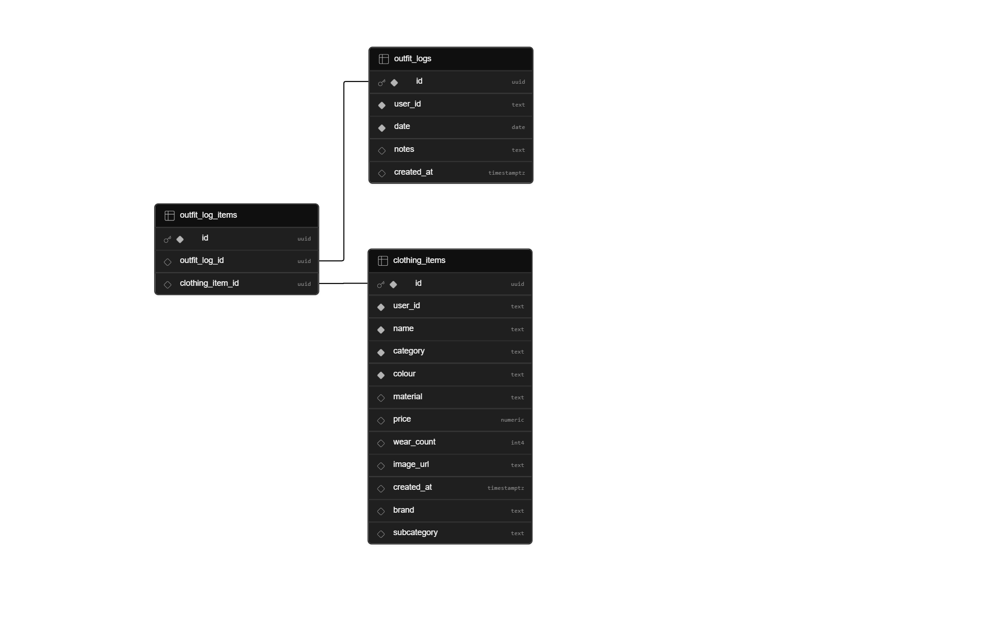

---
 
## Tech Stack
 
| Layer | Technology |
| --- | --- |

| App Framework | React Native, Expo |
| Navigation | Expo Router (file-based tab navigation) |
| PostgreSQL Database | Supabase |
| File Storage | Supabase Storage (community post images) |
| Authentication | Firebase Authentication (email + password) |
| Weather API | Open-Meteo |
| Location | expo-location |
| Image Capture | expo-image-picker |
| Custom Icons | react-native-svg |
| Version Control | Git, GitHub |

> **Note:** Node.js / Express.js and Upstash Redis are listed as planned backend infrastructure for features such as the trending outfit algorithm and server-side caching. They are not yet integrated into the current client-side build.

---

 
## Project Log
 
<a href="https://docs.google.com/spreadsheets/d/1fuehwJMzX3WnRN_kk11JHXUMRSaRDCETw6iLsPMIkKk/edit?gid=0#gid=0">Project Log</a>
 
---

## Project Video

<a href="https://drive.google.com/file/d/19ZwgU1LJ1aS_Iv6AINE2uhheuhCk-wXR/view?usp=drive_link">Project Video</a>

---

## Project Poster

<a href="https://drive.google.com/file/d/1DDuToza_e9mqj4owryR6hV0lA5SqY5g6/view?usp=sharing">Project Poster</a>

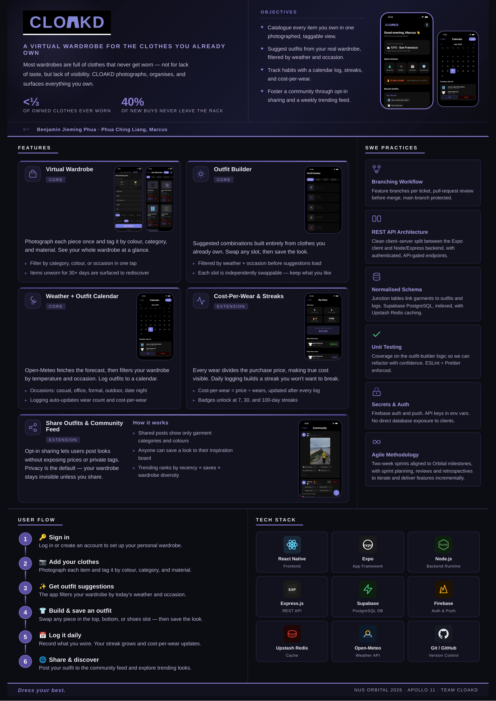

---
 

<em>Dress your best. &nbsp;·&nbsp; Team CLOAKD</em>

Benjamin Jieming Phua &nbsp;·&nbsp; Phua Ching Liang, Marcus
