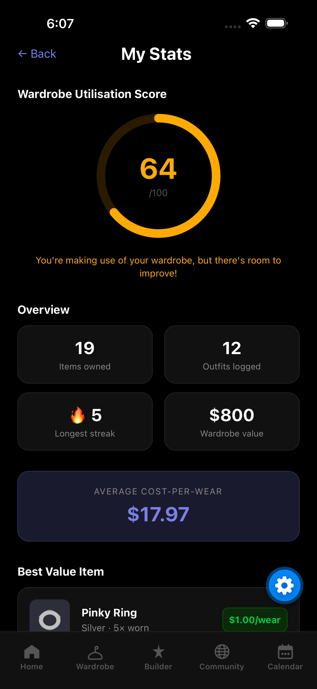
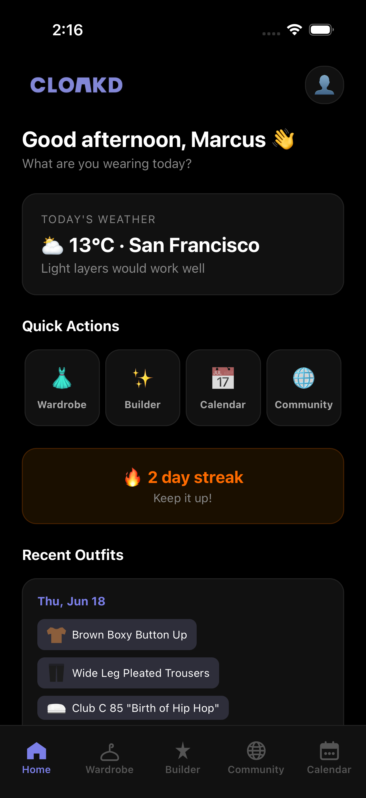
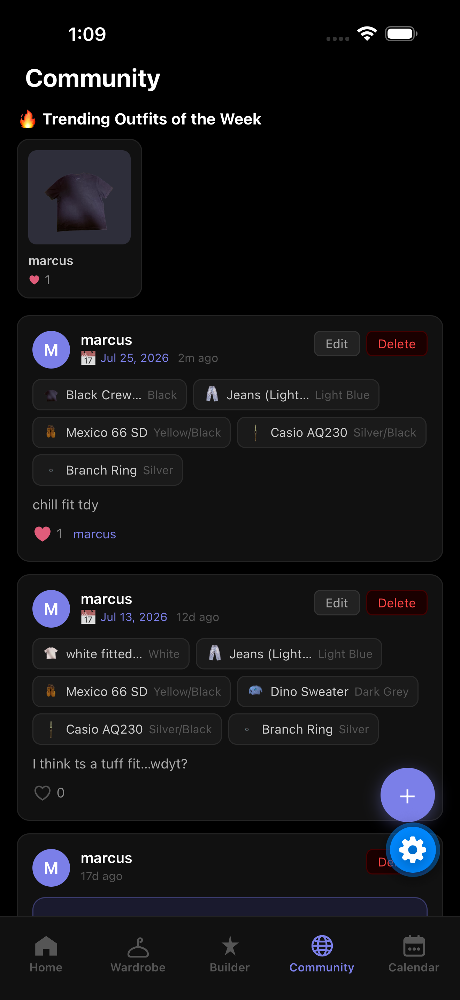

  

<h1 align="center">CLOAKD</h1>

<em>Dress your best.</em>

 
## Final Submission
 
**Team Name:** CLOAKD
 
**Proposed Level of Achievement:** Apollo 11
 
---

 
## Motivation
 
For most people, us included, getting dressed is stressful. You stand in front of a full wardrobe and somehow still feel like you have nothing to wear. CLOAKD reframes that daily moment as something expressive and enjoyable instead of a chore and removes the anxiety from picking out an outfit.
 
Most people wear fewer than a third of the clothes they own. The average piece of clothing gets worn just 7 times before it's thrown away and 40% of what we buy never gets worn at all. People keep buying new clothes and feeling like they constantly have nothing to wear not because they lack options, but because they can't see what they already have. CLOAKD solves a **visibility problem, not a shopping problem.**
 
Fast fashion is one of the most polluting industries in the world, but telling people to "buy less" doesn't work. CLOAKD takes a different approach by making it fun, social and rewarding to get more out of the clothes you already own. The cost-per-wear tracker and wardrobe utilisation score turn sustainability into a game rather than a guilt trip.
 
We also wanted to build something that brings people together around style in a way that feels real and also to learn how to take an idea from nothing and turn it into something real while picking up software engineering skills along the way by building something we actually care about.
 
---
 
## Vision
 
CLOAKD will be a mobile app for iOS and Android, built with React Native and Expo. It lets users digitise their entire wardrobe and receive daily outfit suggestions built entirely from clothes they already own, filtered by real-time weather and occasion.
 
The app is designed around a simple daily loop: open the app, get a suggestion tailored to today's weather and occasion, log what you wore and watch your wardrobe come alive through stats, streaks and community sharing.
 
Ultimately, we envision CLOAKD as the app people reach for every morning, the one that changes how they relate to the clothes they already own, reduces mindless overconsumption and makes getting dressed something enjoyable.

---

## User Stories
 
1. As a person who wants to dress better and improve my style, I want to be able to visualise and plan my outfits.
2. As a person who struggles with deciding what to wear, I want to be able to receive outfit suggestions for the day.
3. I want to be able to dress well and look stylish no matter the weather, even if it is a blazing hot day or a rainy day with thunderstorms. I also want to be able to dress appropriately for the occasion, such as date nights, formal occasions or gym days.
4. I want to be able to take inspiration from others' outfits and share my own.
5. As a frugal person, I want to be able to track how much value and how many wears I am getting out of my clothes.
6. I want to keep track of the outfits I have worn each day so that I do not repeat outfits too frequently.
7. As someone with a large wardrobe, I want to be able to search and filter my clothes by colour, category or material so that I can quickly find what I'm looking for without digging through my closet.
8. As someone who hasn't worn certain pieces in a long time, I want to be reminded of clothes I've forgotten about so that I can rediscover and make better use of them.
9. As someone who is trying to be more intentional about shopping, I want to see which gaps actually exist in my wardrobe before buying anything new.
10. As a conscious consumer, I want to understand the true cost of my purchases over time so that I can justify spending more on quality pieces that I'll wear repeatedly.
11. As someone who enjoys fashion, I want to browse trending outfits in the community and save looks that inspire me so that I have a personalised mood board to reference when planning my own outfits.
12. As someone who enjoys tracking personal progress, I want to look back at my outfit history over weeks and months so that I can see how my personal style has evolved.

---

## Proof of Concept

  

  

  

  

  

  

  

  

  

  

  

  

---

 
## Scope of Project
 
CLOAKD is a mobile app that lets users photograph and catalogue every clothing item they own, then suggests daily outfits built entirely from their existing wardrobe — filtered by real-time weather and occasion. Users log outfits to a calendar, track cost-per-wear statistics, build daily streaks, earn achievement badges, and optionally share looks to a community feed.

---

 
## Features

### User Account Authentication

  

  

Users are authenticated with their own unique account via the Firebase SDK Authentication (email and password). FirebaseAuthExceptions are handled within a try-catch block and an alert is displayed when the user keys in an invalid input. Only upon successful login or account registration is the user routed to the home page.

Users can either log in with an existing account or sign up with their name, email and password. If account credentials are correct, they are redirected to the home page. Account deletion with password re-authentication is also fully supported.

---

 
### Virtual Wardrobe

  

  

Users add their clothes by uploading a photo of each item and tagging it with basic details such as colour, category, subcategory, material, brand and purchase price. The wardrobe screen displays all items at a glance, filterable by category, colour or subcategory in one tap. Items that have not been worn for 30 or more days and new items that have been added but are yet to be worn are surfaced automatically to encourage rediscovery.

Users can save clothing items with full metadata to Supabase. The wardrobe grid view displays all saved items with their uploaded photos. Image capturing with background removal is implemented. Filtering by category, colour and subcategory, as well as 30-day rediscovery surfacing, are both fully implemented.
 
---
 

### Outfit Builder

  

  

 
The outfit builder suggests outfit combinations built entirely from clothes the user already owns. The user is presented with a top, bottom, outerwear, footwear and accessories slot. Each slot is independently swappable, meaning the user can keep what they like and shuffle individual pieces. Weather and occasion filters are applied before suggestions load. Finalised outfits can be saved and logged.

Basic outfit builder feature has been created. The builder retrieves real-time weather data and prompts for occasion (casual, office, formal, outdoor, date night). Users can select each individual item manually or click the generate button to auto-build a colour-coordinated outfit from their wardrobe. Generating an outfit produces a layered visual preview so users can see how items combine before logging. The 30-day rediscovery logic and pushing of unworn pieces are fully integrated into the builder.

---

 
### Occasion and Weather Filter

  

 
The filter asks the user where they are going and what they will be doing. It uses real-time weather data from the Open-Meteo API for the user's current location and filters the wardrobe to suggest outfits suitable for conditions and occasion. Supported occasions: casual, office, formal, outdoor, date night.

Open-Meteo API integration is complete and returns live weather data for the user's current location. The logic to filter wardrobe items by temperature range and occasion tag is connected to the outfit builder.
 
---
 

### Outfit Calendar

  

The outfit calendar acts as a personal style diary. Every time a user logs an outfit, it is recorded against the specified date. Users can look back to see exactly what they wore and when. Logging an outfit automatically updates the wear count and cost-per-wear for every item in the outfit. Users can also edit and delete outfits that have been logged previously.

The calendar can be navigated by month. Logging an outfit to a date is functional and stored in the database. Automatic updating of wear counts, wear dates and cost-per-wear on log is complete. Visual indicators for logged days and the current date are displayed on the calendar grid.
 
---

 
### Share Outfits

  

  

 
Users can opt in to post outfits to the CLOAKD community feed. Privacy is the default — a user's wardrobe stays invisible unless they choose to share. Shared posts display garment categories, colours and item photos. Other users can like posts and view who else has liked them.

The community feed is fully functional. Users can select a logged outfit, attach a photo and caption, and share it to the community feed. Each post displays the outfit date, caption, shared photo, and the individual clothing items as tappable chips with their wardrobe photos. Tapping a clothing chip opens a detail panel showing the item's name, category, subcategory, colour, brand, purchase price and material.

The liking system is complete. Users can like and unlike any post with a single tap. Like counts update immediately with optimistic UI and revert automatically on error. Users can tap the like count to see a list of everyone who has liked the post.

When a user updates their username in Settings, it propagates automatically across all their existing posts and likes in the community feed.
 
---

 
### Settings Page

  

A dedicated settings screen lets users manage their account details and app preferences in one place. Users can set a display username, choose their preferred temperature unit, select their currency, and control the visibility of their profile. Account deletion is available as a permanent action behind a password confirmation step.

The settings page is complete. Users can:

- **Username** — set a display name (minimum 3 characters, unique) that appears on all community posts and likes. Changing the username automatically updates it across all existing posts and likes in real time.
- **Temperature Unit** — toggle between °C and °F. The selection is persisted and reflected immediately in the home page weather card.
- **Currency** — select from SGD, USD, EUR, GBP, JPY, AUD, CAD, HKD, MYR, or IDR for cost-per-wear display.
- **Profile Visibility** — toggle between Public (outfits visible to the community) and Private (outfits visible to the user only).
- **Delete Account** — permanently deletes the account and all associated wardrobe data after password re-authentication. This action is irreversible.

---

 
### Profile Page

  

Each user has a profile page that displays their username, profile photo, email address, badge wall, stats and settings. The profile is accessible from the home page and serves as a personal hub for reviewing personal style history and achievements.

The profile page is accessible from the profile button on the home page header. The user can view their username, email address and profile photo, and navigate to the stats page, settings page and badge wall. The user can also log out from this page.

---

### Statistics Page

  

Users can view their account statistics on the statistics page. It contains figures such as their Wardrobe Utilisation Score, total number of items owned and outfits logged, longest streak, total wardrobe value, average cost-per-wear for all the clothing items in their wardrobe, as well as their best value and most worn items.

Users can also see their total wardrobe value and the total number of clothing items they own if they are interested to see how much they have spent on their wardrobe as a whole.

The average cost-per-wear figure shows the average cost-per-wear of all the clothing items in a user's wardrobe and also helps to encourage them to wear their clothing items more and log outfits to get better value out of the clothing items they already own.

---

 
### Cost-Per-Wear Tracker

  

When adding clothing items, users input the purchase price. Cost-per-wear is calculated as price divided by the number of wears and updated automatically each time the item is logged as part of an outfit. The wardrobe view surfaces this figure alongside wear count for each item.

The cost-per-wear tracker is fully built. Users can see the number of times they have worn each piece and its cost-per-wear in the wardrobe page. Logging an outfit in the calendar automatically updates the wear count and cost-per-wear. The stats page shows the best value item (lowest cost-per-wear), average cost-per-wear across the wardrobe, and the most worn item.

---

### Streak System

  

Every day a user logs an outfit, their streak grows. Missing a day resets the counter. Badges unlock at 7-day, 30-day and 100-day milestones to keep users motivated to open the app daily.

The streak system is fully implemented. A streak is activated when a user logs outfits on 2 or more consecutive days. Missing a day resets the streak to 0. The streak counter is live on the home page with motivational subtext. Users with no active streak are prompted to log 2 days in a row to start one.

The streak is also visible in the community feed: when a user with an active streak (2+ days) shares an outfit, a fire icon and streak count appear beside their username on the post card, visible to all community members.

The badges page is complete with 19 badges. Users automatically unlock badges once they meet each badge's requirements and can share newly unlocked badges directly to the community feed.

---

 
### Community Feed
 
The community feed surfaces outfit posts from all users, ordered by recency. Posts include the outfit date, caption, photo and item chips. Users can like posts, view likers, and tap individual item chips to see full clothing details. The feed supports posting, editing and deleting, and displays streak badges for active users.

---

### Wardrobe Utilisation Score

  

The wardrobe utilisation score gives users a single number that answers the question: how much of what you own are you actually wearing? It sits at the top of the Stats page with its own dedicated header and acts as the headline metric for wardrobe health.

The score is calculated as the percentage of wardrobe items that are **not forgotten**, rounded up to the nearest whole number, capped at 100. An item is considered forgotten if it has never been worn, or if its most recent wear was more than 30 days ago — the same definition used by the wardrobe rediscovery section.

> Score = ⌈ (items worn in the last 30 days ÷ total items) × 100 ⌉, capped at 100

The score updates automatically whenever an outfit is logged or an item is added or deleted, since both events change either the numerator (items with a recent wear) or the denominator (total items).

The score and its progress ring are colour-coded by tier:

| Score Range | Colour | Tooltip |
| --- | --- | --- |
| 0 – 50 | Red | "You have many unworn clothes, try giving them a chance!" |
| 51 – 75 | Yellow | "You're making use of your wardrobe, but there's room to improve!" |
| 76 – 90 | Green | "Great work! Most of your wardrobe is being put to good use." |
| 91 – 100 | Purple | "Outstanding! Your wardrobe utilisation is exceptional!" |

The UI renders the score inside a circular progress ring drawn with `react-native-svg`. The ring arc is filled proportionally to the score (0 = empty, 100 = full circle). Both the arc and the central score label change colour together according to the active tier.

---

### Trending Outfits

  

On the community feed page, users share their outfits and like other users' shared outfits. A horizontal scroll section has been created at the top of the community feed page to showcase the trending outfits of the week. The formula to calculate the most trending outfits is likeCount / (ageInHours + 2)^1.5 and it helps to ensure that a new post with fewer likes can outrank an older post with more likes, keeping the section feeling more current and up to date with trends rather than just all-time popular outfits.

Only outfit posts within the last 7 days with at least one like are eligible to be featured in this section and only the top 10 outfits by score will be showcased. The score is automatically recomputed and the outfits are updated whenever posts or like counts change.

If a user has set their account to private, their outfits will not be featured in this section even if they are less than 7 days old and have at least one like.

---

## Testing

### Testing Approach

CLOAKD is tested through a combination of manual end-to-end testing, structured feature walkthroughs, and unit tests targeting edge cases in core business logic. Given the app's reliance on real-time data from Firebase and Supabase, integration testing is prioritised to ensure the full data flow works correctly in production conditions. Unit tests focus on pure functions (cost-per-wear calculation, streak logic, colour matching) that can be isolated from the network layer.

---

### Unit Tests — Edge Cases

The following edge cases are covered by unit tests on the core logic functions.

#### Cost-Per-Wear Calculation

CPW is computed as `price / wear_count` when `wear_count > 0`, and falls back to `price` when `wear_count === 0`. The CPW badge is only rendered when `price > 0`.

| Test Case | Input | Expected Output |
|---|---|---|
| Item never worn, has price | price = $120, wears = 0 | Displays $120.00/wear (full price used as CPW — no division by zero) |
| Item worn once | price = $120, wears = 1 | Displays $120.00/wear |
| Item worn many times | price = $50, wears = 1000 | Displays $0.05/wear (rounds to 2 decimal places) |
| Free item (price = $0) | price = $0, wears = 5 | CPW badge not shown (hidden by `price > 0` guard) |
| Price with many decimal places | price = $99.999, wears = 3 | Displays $33.33/wear (`.toFixed(2)` applied) |
| Item with no price set | price = $0, wears = 0 | CPW badge not shown |

#### Streak Calculation

A streak requires the most recent logged date to be either today or yesterday. Dates are deduplicated and sorted before counting. A streak is only reported when 2 or more consecutive days are found.

| Test Case | Input | Expected Output |
|---|---|---|
| No outfits logged | dates = [] | Streak = 0 |
| Single outfit logged today | dates = [today] | Streak = 0 (need 2+ consecutive days) |
| Two consecutive days | dates = [today, yesterday] | Streak = 2 |
| All consecutive from today | dates = [today, d-1, d-2, d-3] | Streak = 4 |
| Gap in streak | dates = [today, yesterday, d-3, d-4] (d-2 missing) | Streak = 2 (chain breaks at the gap) |
| Most recent date is yesterday, not today | dates = [yesterday, d-2, d-3] | Streak = 3 (yesterday counts as anchor) |
| Most recent date is 2+ days ago | dates = [d-2, d-3, d-4] | Streak = 0 (too stale to count) |
| Dates out of order | dates = [d-3, today, d-1, d-2] | Streak = 4 (sorted correctly before calculation) |
| Duplicate date entries | dates = [today, today, yesterday] | Streak = 2 (deduplicated before calculation) |

#### Outfit Colour Matching

Colour compatibility is determined by family groups (red/burgundy/maroon, blue/cobalt/sky blue, etc.) and a neutral set (white, black, grey, beige, navy, etc.). Neutrals are compatible with everything. After 200 failed attempts to build a harmonious outfit, the generator falls back to the first available item in each pool regardless of colour.

| Test Case | Expected Output |
|---|---|
| All items are neutrals | Any combination is accepted as harmonious |
| Item colour not in any family and not neutral | Treated as incompatible with any non-neutral; fallback outfit used after 200 attempts |
| Wardrobe has only one item per slot | Fallback always fires; that item is used regardless of colour match |
| All items filtered out by weather and occasion (no tops or bottoms remain) | Full unfiltered wardrobe used as fallback — no empty state |
| Occasion filter leaves no tops or bottoms | Full unfiltered wardrobe used as fallback |

#### Username Validation

Minimum length is 3 characters (checked via `.trim().length < 3`). Uniqueness is enforced via a Supabase unique constraint (error code `23505`). There is no maximum length enforced in the app. Internal spaces are permitted.

| Test Case | Input | Expected Output |
|---|---|---|
| Exactly 3 characters (boundary) | "abc" | Accepted |
| 2 characters (below minimum) | "ab" | Rejected — "Username must be at least 3 characters" alert |
| Empty string | "" | Rejected — same alert |
| Username already taken | existing username | Rejected — "That username is already in use" alert |
| Username with internal spaces | "my name" | Accepted — spaces are not stripped or rejected |
| Very long username | 100-character string | Accepted — no maximum length is enforced |

#### Weather Filter

The weather filter uses four temperature thresholds (°C): above 28, 22–28, below 18, below 10. Each threshold blocks specific subcategories rather than requiring specific ones. If applying the filter leaves the wardrobe with no tops or no bottoms, the full unfiltered wardrobe is used instead.

| Test Case | Temperature | Expected Behaviour |
|---|---|---|
| Hot (> 28°C) | 35°C | Heavy outerwear (jacket, coat, puffer, blazer, windbreaker), sweatpants, hoodies and crewnecks excluded |
| Warm (22–28°C) | 25°C | Only heavy outerwear (coat, puffer) excluded |
| Mild (18–22°C) | 20°C | No items excluded |
| Cool (< 18°C) | 15°C | Sandals, shorts, and light dresses excluded |
| Cold (< 10°C) | 5°C | All dresses and all exposed-top subcategories (tank, crop, halter, etc.) also excluded |
| Filter leaves no tops or bottoms | Any | Full unfiltered wardrobe used as fallback — no empty result |
| Location permission denied | N/A | Weather card shows "Location unavailable"; builder defaults to 22°C (no alert or prompt shown) |

---

### Manual Test Cases

#### User Authentication
| Test | Expected Result | Status |
| --- | --- | --- |
| Sign up with a new email and password | Account created, redirected to home page | Pass |
| Sign up with an email already registered | Error alert displayed, no account created | Pass |
| Sign up with a password under 6 characters | Error alert displayed | Pass |
| Log in with valid credentials | Redirected to home page | Pass |
| Log in with incorrect password | Error alert displayed, no redirect | Pass |
| Log in with unregistered email | Error alert displayed | Pass |
| Delete account with correct password | Account and data removed, redirected to login | Pass |
| Delete account with wrong password | Error alert, account retained | Pass |
| Session persists after app close | User remains logged in on reopen | Pass |

#### Virtual Wardrobe
| Test | Expected Result | Status |
| --- | --- | --- |
| Add a clothing item with all fields | Item saved and visible in wardrobe grid | Pass |
| Add a clothing item with only required fields | Item saved with blank optional fields | Pass |
| Add a clothing item with photo | Photo displayed in wardrobe grid and builder | Pass |
| Add a clothing item without a photo | Clothing icon placeholder shown | Pass |
| Edit an existing clothing item | Updated details reflected immediately | Pass |
| Delete a clothing item | Item removed from wardrobe and any logged outfits | Pass |
| Filter wardrobe by category | Only matching items shown | Pass |
| Filter wardrobe by colour | Only matching items shown | Pass |
| Filter wardrobe by subcategory | Only matching items shown | Pass |
| Wardrobe with zero items | Empty state message shown, no crash | Pass |
| 30-day rediscovery section | Items unworn for 30+ days surfaced at top | Pass |
| New unworn item surfaced | Newly added but never-worn items appear in rediscovery | Pass |

#### Outfit Builder
| Test | Expected Result | Status |
| --- | --- | --- |
| Generate an outfit | Items selected from wardrobe matching weather and occasion | Pass |
| Manually swap a slot | Selected item replaces the slot | Pass |
| Log a generated outfit | Outfit saved to calendar on the selected date | Pass |
| Generate outfit with empty wardrobe | Empty state prompt shown, no crash | Pass |
| Generate outfit with wardrobe missing one category | Builder fills available slots, leaves missing slot empty | Pass |
| Outfit preview renders correctly | Layered clothing preview shown in correct order | Pass |
| Preview updates when slot is swapped | Preview refreshes immediately on item change | Pass |

#### Outfit Calendar
| Test | Expected Result | Status |
| --- | --- | --- |
| Log an outfit to a date | Date highlighted on calendar, wear counts updated | Pass |
| Log an outfit to a past date | Accepted and stored correctly | Pass |
| Log a second outfit to the same date | Replaces or appends correctly, no duplicate | Pass |
| View a logged outfit | Items displayed correctly for that date | Pass |
| Navigate between months | Calendar updates without data loss | Pass |
| Delete a logged outfit | Date indicator removed, wear counts decremented | Pass |

#### Streak System
| Test | Expected Result | Status |
| --- | --- | --- |
| Log outfits on 2 consecutive days | Streak of 2 shown on home page | Pass |
| Skip a day after an active streak | Streak resets to 0 | Pass |
| Log multiple outfits on the same day | Streak does not double-count | Pass |
| Streak badge on community post | Fire icon and count appear beside username | Pass |
| Streak refreshes on home tab focus | Updated count shown after returning from calendar | Pass |
| No streak when only one day logged | "Log 2 days in a row to start a streak" prompt shown | Pass |

#### Community Feed
| Test | Expected Result | Status |
| --- | --- | --- |
| Share an outfit post | Post appears at top of community feed | Pass |
| Share a post with photo | Photo displayed in post card | Pass |
| Share a post without photo | Post displays with item chips only, no crash | Pass |
| Like a post | Like count increments immediately | Pass |
| Unlike a post | Like count decrements immediately | Pass |
| Like reverts on network error | Count restored to pre-tap state | Pass |
| View likers list | All usernames who liked the post are shown | Pass |
| Tap clothing chip in feed | Item detail modal opens with correct data | Pass |
| Tap clothing chip in fullscreen post | Item detail popup opens over fullscreen view | Pass |
| Tap item card in fullscreen post | Detail popup with item photo and metadata appears | Pass |
| Edit own post | Caption and photo updated in feed | Pass |
| Delete own post | Post removed from feed | Pass |
| Feed scrollable with many posts | Scroll functions correctly, no layout freeze | Pass |
| Post with no items | Post renders cleanly with no chip section | Pass |

#### Settings
| Test | Expected Result | Status |
| --- | --- | --- |
| Change username | New username reflected on all existing posts and likes | Pass |
| Set username under 3 characters | Error shown, username not saved | Pass |
| Set duplicate username | Error shown, username not saved | Pass |
| Switch temperature unit to °F | Home page weather updates to Fahrenheit | Pass |
| Switch temperature unit back to °C | Home page weather updates back | Pass |
| Change currency | Currency symbol updates in cost-per-wear displays | Pass |
| Currency setting persists on app reopen | Correct currency shown after closing and reopening app | Pass |
| Set profile to private | Posts hidden from community feed | Pass |

#### Cost-Per-Wear
| Test | Expected Result | Status |
| --- | --- | --- |
| Item with 0 wears | Displays "—" or equivalent, no division by zero error | Pass |
| Log outfit containing item | Wear count increments, CPW recalculates | Pass |
| Stats page — best value item | Item with lowest CPW shown correctly | Pass |
| Stats page — most worn item | Item with highest wear count shown correctly | Pass |

---

### Devices Tested

| Device | OS | Method |
| --- | --- | --- |
| iPhone 17 (Simulator) | iOS 18 | Xcode iOS Simulator |

> Testing was conducted on a simulated iPhone 17 via Xcode rather than a physical device. This is because the version of Expo Go available on physical devices had not been updated to support the SDK version used in this project.

---

### Known Limitations

- Testing is currently limited to the iOS Simulator. Physical device and Android compatibility testing has not been completed.
- Weather data accuracy is dependent on the Open-Meteo API and device location permissions being granted. Location is simulated in the Xcode Simulator and may not reflect real-world GPS accuracy.
- Unit tests are described and verified manually against isolated function behaviour. A formal test runner (e.g. Jest) has not been integrated into the project build pipeline.

 
## Timeline and Development Plan
 
| Milestone | Date | Task & Description |
| --- | --- | --- |
| Liftoff | 10 - 18 May 2026 | Create project poster. |
| Liftoff | 10 - 18 May 2026 | Film, edit and craft liftoff project poster. |
| Liftoff | 10 - 18 May 2026 | Finalise project features and review proposal. |

> **Evaluation Liftoff: 18 May 2026**
> - Create project poster and video.
> - Solidify plans for CLOAKD app.
> - Self-learn all the tools in our tech stack to build our CLOAKD app.

| Milestone | Date | Task & Description |
| --- | --- | --- |
| 1 | 19 - 24 May 2026 | Set up Expo project, Firebase backend and Supabase backend. Integrate Expo with Firebase for user authentication and Supabase for clothing item information. |
| 1 | 19 - 24 May 2026 | Create log-in and sign-up pages with user email and password for authentication and verification. |
| 1 | 19 - 24 May 2026 | Create home page as a dashboard that is connected to all other pages and features. |
| 1 | 24 - 31 May 2026 | Create virtual wardrobe feature with image capture and input of clothing item details such as colour, material, subcategory and purchase price. Link to Supabase for storage of details. |
| 1 | 24 - 31 May 2026 | Create outfit calendar feature with ability to log outfits and highlight dates where outfits have been logged. |
| 1 | 24 - 31 May 2026 | Create Cost-Per-Wear extension to update wear count every time the clothing item is logged in an outfit. Use purchase price / number of wears to calculate. |

> **Evaluation Milestone 1: 1 June 2026**
> - Able to add clothes to the virtual wardrobe + store and access data.
> - Outfit Calendar functional.
> - Cost-per-wear calculation functional. Integration with Virtual Wardrobe complete.
> - Account sign-up and log-in with authentication complete.
> - Basic UI complete.

| Milestone | Date | Task & Description |
| --- | --- | --- |
| 2 | 2 - 15 June 2026 | Create outfit builder feature and link it to the virtual wardrobe to directly access all clothing items. |
| 2 | 2 - 15 June 2026 | Add function that pushes clothes that have not been worn in a while for outfit builder feature. |
| 2 | 2 - 15 June 2026 | Include occasion and weather filter to suggest outfit recommendations for outfit builder feature. |
| 2 | 16 - 28 June 2026 | Create settings page. | 
| 2 | 16 - 28 June 2026 | Build community feed and outfit sharing feature. |

> **Evaluation Milestone 2: 29 June 2026** 
> - Occasion and Weather Filter functional.
> - Outfit builder functional.
> - Virtual Wardrobe backend complete. Integration with Cost-per-wear Tracker done.
> - Community feed frontend complete.

| Milestone | Date | Task & Description |
| --- | --- | --- |
| 3 | 1 - 26 July 2026 | Complete streak system. |
| 3 | 1 - 26 July 2026 | Create achievement badges for streaks, outfits logged, cost-per-wear milestones and wardrobe size. |
| 3 | 1 - 26 July 2026 | Ensure community feed is fully functional end-to-end. |
| 3 | 1 - 26 July 2026 | Complete outfit sharing feature. |
| 3 | 1 - 26 July 2026 | Outfit preview layered visual. |

> **Evaluation Milestone 3: 27 July 2026** 
> - Streak system functional with badges and achievement tokens.
> - Share Outfits feature fully functional.
> - Community feed fully functional.
> - Outfit preview complete.

| Milestone | Date | Task & Description |
| --- | --- | --- |
| Splashdown | 1 - 25 August 2026 | Fix all bugs and improve UI. |
| Splashdown | 1 - 25 August 2026 | Make quality of life updates and improvements. |

> **Evaluation Splashdown: 26 August 2026** 
> - Fix all bugs and improve UI.
> - Quality of life updates and improvements.

---

 
## Database Schema
 

---
 
## Tech Stack
 
| Layer | Technology |
| --- | --- |
| App Framework | React Native, Expo |
| Navigation | Expo Router (file-based tab navigation) |
| PostgreSQL Database | Supabase |
| File Storage | Supabase Storage (community post images) |
| Authentication | Firebase Authentication (email + password) |
| Weather API | Open-Meteo |
| Location | expo-location |
| Image Capture | expo-image-picker |
| Custom Icons | react-native-svg |
| Version Control | Git, GitHub |

---

 
## Project Log
 
<a href="https://docs.google.com/spreadsheets/d/1fuehwJMzX3WnRN_kk11JHXUMRSaRDCETw6iLsPMIkKk/edit?gid=0#gid=0">Project Log</a>
 
---

## Project Video

<a href="https://drive.google.com/file/d/19ZwgU1LJ1aS_Iv6AINE2uhheuhCk-wXR/view?usp=drive_link">Project Video</a>

---

## Project Poster

<a href="https://drive.google.com/file/d/1DDuToza_e9mqj4owryR6hV0lA5SqY5g6/view?usp=sharing">Project Poster</a>

---
 

<em>Dress your best. &nbsp;·&nbsp; Team CLOAKD</em>

Benjamin Jieming Phua &nbsp;·&nbsp; Phua Ching Liang, Marcus

